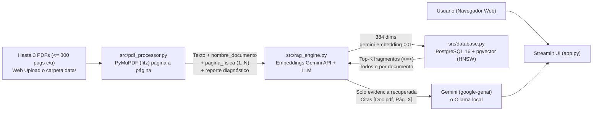

# Sistema RAG para Consulta de Manuales de Empresa de Transporte

Aplicación modular en Python para ingesta, diagnóstico, indexación vectorial idempotente y consulta con citas verificables sobre manuales técnicos de una empresa de transporte (**Manual de operaciones**, **Procedimiento de mantenimiento** y **Protocolo de atención de incidentes**).

---

## Arquitectura del Sistema



### Estructura del proyecto

- `app.py`: Interfaz web Streamlit con barra lateral de inventario en tiempo real y tres pestañas (`Consultas a los Manuales`, `Ingesta de PDFs y Diagnóstico` e `Inventario PostgreSQL`).
- `src/config.py`: Carga centralizada de variables de entorno desde `.env` mediante la clase `Settings` y resolución segura de modelos Gemini.
- `src/pdf_processor.py`: Extracción eficiente página por página con PyMuPDF (`fitz`), numeración física base 1, fragmentación por página con solapamiento, captura aislada de errores por archivo o página y detección exacta de páginas sin texto seleccionable.
- `src/database.py`: Inicialización automática de la extensión `vector`, esquema relacional (`documentos` y `fragmentos`), índice vectorial HNSW (`vector_cosine_ops`), persistencia transaccional idempotente y búsqueda por similitud coseno (`<=>`).
- `src/rag_engine.py`: Generación de embeddings de 384 dimensiones mediante Gemini API (`gemini-embedding-001`, `output_dimensionality=384` y normalización L2), control estricto de evidencia en español y soporte dual `gemini` (`google-genai`, Interactions API) / `ollama`.
- `docker-compose.yml`: Servicio PostgreSQL 16 con la imagen oficial `pgvector/pgvector:pg16` y volumen persistente `postgres_data`.
- `tests/`: Pruebas unitarias automatizadas con `pytest`.

> **Nota sobre el modelo Gemini:** La versión `gemini-2.5-flash` está deprecada en el SDK actual `google-genai` (`>= 3.2.0`), por lo que la aplicación utiliza `gemini-4-hydrogen` con la **Interactions API** (`client.interactions.create`) y sustituye automáticamente identificadores `gemini-2.5-*` si se configuran en `.env`.

---

## Esquema de Base de Datos (`pgvector`)

Al iniciar la aplicación (`VectorDatabase.initialize_schema`), se crean automáticamente:

1. Extensión `vector`:
   - `CREATE EXTENSION IF NOT EXISTS vector;`
2. Tabla `documentos`:
   - `id` (`SERIAL PRIMARY KEY`)
   - `nombre_archivo` (`TEXT UNIQUE NOT NULL`)
   - `hash_sha256` (`VARCHAR(64) NOT NULL`)
   - `total_paginas` (`INTEGER NOT NULL`)
   - `fecha_ingesta` (`TIMESTAMPTZ NOT NULL DEFAULT NOW()`)
3. Tabla `fragmentos`:
   - `id` (`SERIAL PRIMARY KEY`)
   - `documento_id` (`INTEGER NOT NULL REFERENCES documentos(id) ON DELETE CASCADE`)
   - `pagina_fisica` (`INTEGER NOT NULL`)
   - `indice_fragmento` (`INTEGER NOT NULL`)
   - `contenido` (`TEXT NOT NULL`)
   - `embedding` (`vector(384) NOT NULL`)
   - Restricción única `(documento_id, indice_fragmento)`
4. Índices:
   - `idx_fragmentos_embedding_hnsw` (`USING hnsw (embedding vector_cosine_ops)`)
   - `idx_fragmentos_documento_id` sobre `documento_id`

---

## Manejo Eficiente de Hasta 900 Páginas (3 PDFs × 300 Páginas)

Para procesar hasta **3 manuales de 300 páginas cada uno** sin agotar memoria ni bloquear la interfaz:

1. **Lectura streaming por página y liberación explícita de C-memory:** PyMuPDF (`fitz`) recorre cada PDF página por página (`doc.load_page(i)`), normaliza el texto (eliminando bytes NUL `\x00` incompatibles con PostgreSQL UTF-8) y cierra el documento en bloque `finally` (`doc.close()`). Para archivos en la carpeta `data/`, el hash SHA-256 se calcula por bloques de 1 MiB y el PDF se abre directamente desde disco sin duplicar bytes en RAM.
2. **Fragmentación acotada a la página física:** `split_text_into_chunks` divide cada página individualmente (por defecto `900` caracteres con `150` de solapamiento y ajuste a límites de párrafo/oración/palabra) sin mezclar texto entre páginas consecutivas, garantizando trazabilidad exacta a `pagina_fisica`.
3. **Vectorización por lotes (`batch_size=100`):** `GeminiEmbedder.embed_texts` envía bloques de hasta 100 fragmentos por llamada a `client.models.embed_content` con `output_dimensionality=384`, normalización L2, reintentos con backoff exponencial ante límites de tasa (`429`) y reporte incremental a la barra de progreso de Streamlit.
4. **Inserción por lotes transaccional (`INSERT_BATCH_SIZE=500`):** `psycopg` inserta los fragmentos mediante `executemany` en lotes de 500 registros dentro de una única transacción.
5. **Búsqueda HNSW con `ef_search` ampliado:** En consultas semánticas (especialmente al filtrar por un único documento), se ejecuta `SET LOCAL hnsw.ef_search = 100` y consultas SQL separadas para filtro global o por documento, asegurando el uso eficiente del índice HNSW.

---

## Idempotencia Estricta

La persistencia está diseñada para que volver a procesar uno o varios PDFs ya cargados **nunca duplique filas** ni altere los totales en PostgreSQL:

1. **Verificación previa por `nombre_archivo`, `hash_sha256`, `total_paginas` y conteo de fragmentos:** Si el archivo ya existe con el mismo hash SHA-256 y la misma cantidad de fragmentos (y no está activada la opción *Forzar reemplazo atómico*), se omite el recálculo de embeddings y solo se actualiza `fecha_ingesta` en PostgreSQL (`estado: sin_cambios`).
2. **Reemplazo atómico transaccional (`FOR UPDATE` + `UPDATE` + `DELETE` + `INSERT`):** Si el contenido del PDF cambió (nuevo `hash_sha256`), varió la configuración de chunking o se activó *Forzar reemplazo atómico*, toda la operación ocurre dentro de `with conn.transaction():`:
   - Se bloquea la fila del documento en `documentos` con `SELECT ... FOR UPDATE`.
   - Se actualizan `hash_sha256`, `total_paginas` y `fecha_ingesta`.
   - Se eliminan los fragmentos anteriores de ese `documento_id` y se insertan los nuevos.
   - Si ocurre cualquier fallo intermedio, PostgreSQL revierte la transacción completa sin dejar registros huérfanos ni duplicados.

Los contadores mostrados en la barra lateral y en la pestaña **Inventario PostgreSQL** consultan directamente las tablas `documentos` y `fragmentos`, por lo que permanecen intactos tras reiniciar la aplicación o el contenedor Docker.

---

## Instalación y Puesta en Marcha

### 1. Requisitos previos
- Python **3.11+**
- Docker y Docker Compose
- Clave de API de Google Gemini (`GEMINI_API_KEY`) o una instancia local de Ollama

### 2. Levantar PostgreSQL 16 + `pgvector`

```bash
docker compose up -d
```

Verifica que el contenedor esté saludable (`healthy`):

```bash
docker compose ps
```

### 3. Crear entorno virtual e instalar dependencias

En Windows (PowerShell):

```powershell
python -m venv .venv
.\.venv\Scripts\Activate.ps1
pip install -r requirements.txt
```

En Linux / macOS:

```bash
python3 -m venv .venv
source .venv/bin/activate
pip install -r requirements.txt
```

### 4. Configurar variables de entorno

Copia `.env.example` a `.env` y completa tu clave de API:

```bash
cp .env.example .env
```

Variables principales en `.env`:

- `POSTGRES_HOST`, `POSTGRES_PORT`, `POSTGRES_DB`, `POSTGRES_USER`, `POSTGRES_PASSWORD` (o `DATABASE_URL`)
- `LLM_PROVIDER`: `gemini` (por defecto) o `ollama`
- `GEMINI_API_KEY`: clave de Google AI Studio
- `GEMINI_MODEL`: `gemini-4-hydrogen`
- `GEMINI_THINKING_LEVEL`: `low` (por defecto), `medium`, `high` o `xhigh`
- `OLLAMA_BASE_URL` y `OLLAMA_MODEL` (si usas `LLM_PROVIDER=ollama`)

### 5. Ejecutar la aplicación Streamlit

```bash
streamlit run app.py
```

---

## Guía de Uso

### Ingesta de PDFs y Reporte de Diagnóstico
1. Abre la pestaña **📥 Ingesta de PDFs y Diagnóstico**.
2. Elige cargar hasta **3 archivos PDF** desde el navegador o colócalos en la carpeta `data/` y selecciona **Procesar carpeta local `data/`**.
3. Al finalizar, revisa el **Reporte de Diagnóstico** por documento:
   - Total de páginas del PDF y páginas procesadas.
   - Listado exacto de números de página física sin texto seleccionable (páginas en blanco o escaneadas como imagen).
   - Errores de lectura capturados por archivo o página (sin detener el resto del lote).
   - Total de fragmentos generados y estado de persistencia idempotente.

### Consultas Semánticas y Control de Evidencia
1. En la barra lateral, verifica los contadores en tiempo real de PostgreSQL y selecciona:
   - **Proveedor LLM**: `gemini` u `ollama`.
   - **Alcance de búsqueda**: **Todos los documentos** o un manual específico.
   - **Fragmentos a recuperar (`top_k`)**: entre `3` y `8` (por defecto `5`).
2. Escribe tu pregunta en la pestaña **💬 Consultas a los Manuales**.
3. El sistema responderá en español citando las fuentes en formato `[NombreDocumento.pdf, Pág. X]`. Si la evidencia recuperada no basta para responder, lo declarará explícitamente sin inventar información.
4. Debajo de cada respuesta, despliega la sección **Pasajes exactos utilizados** para auditar el documento, la página física, el puntaje de similitud coseno y el texto literal de cada fragmento enviado al LLM.

---

## Pruebas Automatizadas

Ejecuta la suite de pruebas unitarias con:

```bash
pytest -v
```
